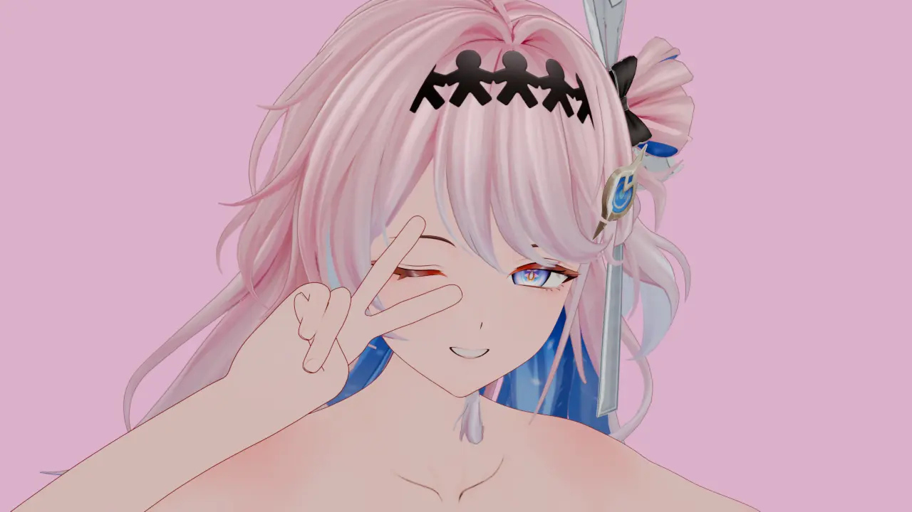
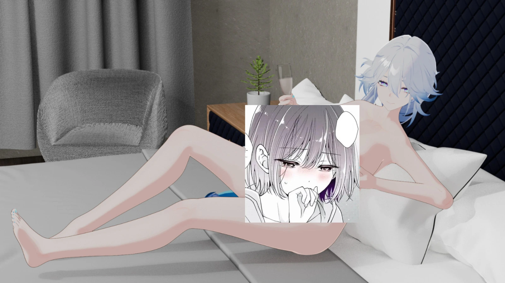

  <h1>Hi, I'm <a href="https://github.com/ouzuka-m">ouzuka-m</a> 👋</h1>
  
<em>Vocational High School Student • Low-Level & Systems Programming • Digital Artist</em>

  

    
    
  

---

### 💻 About Me

I am a vocational high school student passionately delving into the world of **low-level systems programming**, primarily writing in **Rust** and **Assembly**.

- 🔭 **Current Focus:** Dedicating all my development efforts toward a single project — **[Aether](https://github.com/ouzuka-m/aether)**.
- ⚙️ **Core Interests:** Bare-metal development, operating systems architecture, memory safety, and assembly-level optimization.
- 🎨 **Creative Side:** Beyond the code and terminal, I am also an artist creating visual renders.

---

### 🚀 Primary Project

  <table>
    <tr>
      <td width="100%">
        <h3 align="center">🌌 <a href="https://github.com/ouzuka-m/aether">Aether</a></h3>
        

          An experimental low-level operating system project built from the ground up, exploring systems architecture, hardware abstractions, and low-level safety.
        

        

          
          
          
        

      </td>
    </tr>
  </table>

---

### 🛠 Tech Stack & Toolbox

| Domain | Technologies |
| :--- | :--- |
| **Languages** | `Rust` `Assembly (x86_64)` |
| **Systems & Tools** | `Linux` `Git` `Bare-Metal` `OS Dev` |

 

  
  &nbsp;
  
  &nbsp;
  
  &nbsp;
  

---

### 🎨 Art & Visual Works

> *When stepping away from compiling kernels and low-level code, I channel my creativity into visual art.*

Here are some of my renders:

  <table width="100%">
    <tr>
      <td width="50%" align="center">
        
         
        <em>Render #1</em>
      </td>
      <td width="50%" align="center">
        
         
        <em>Render #2</em>
      </td>
    </tr>
  </table>

---

  Crafted with passion by <a href="https://github.com/ouzuka-m">ouzuka-m</a>

